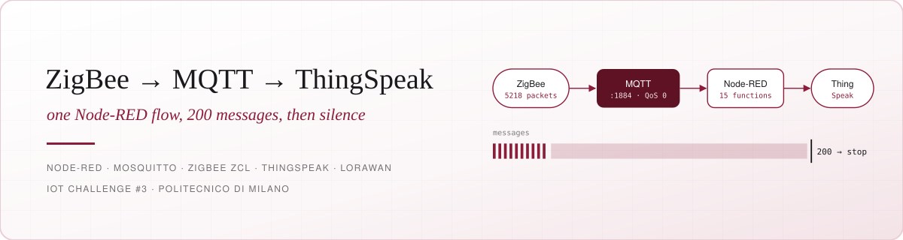
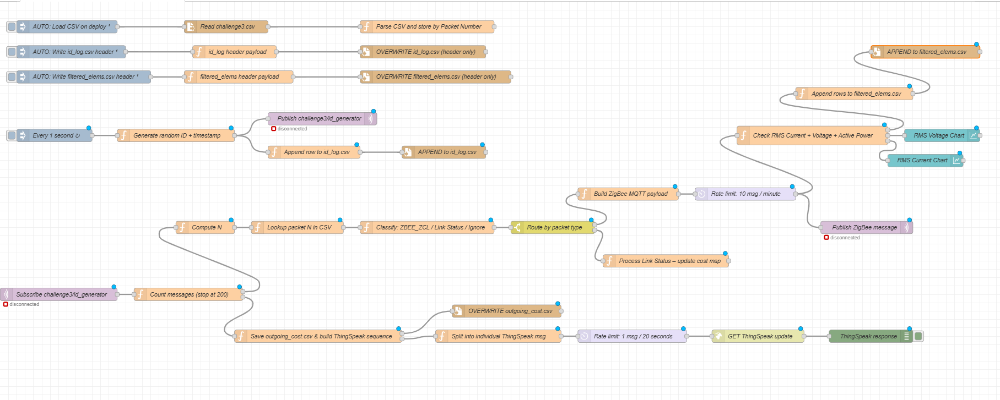
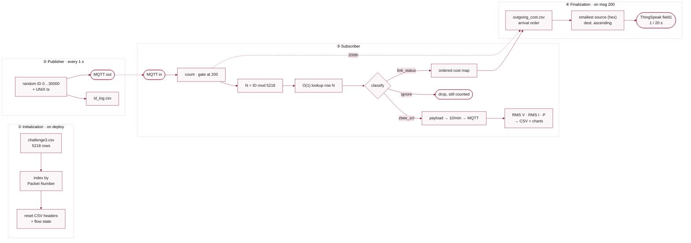
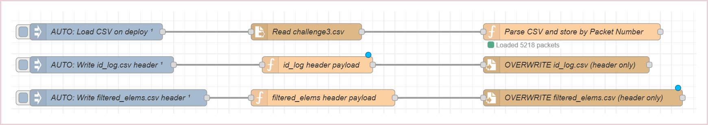
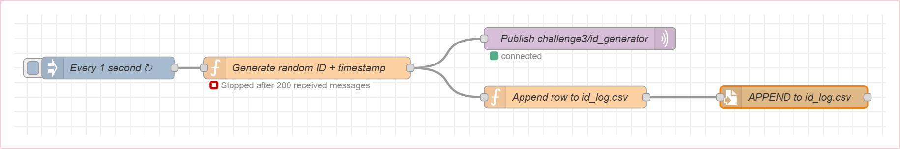
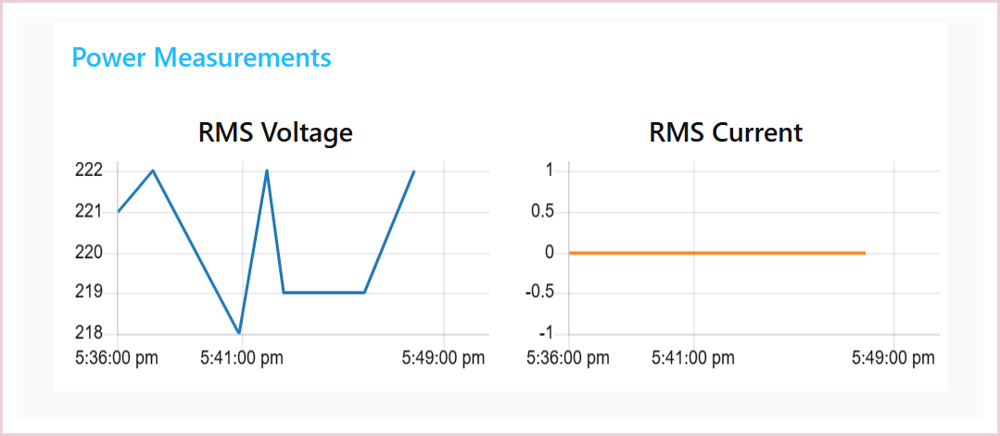
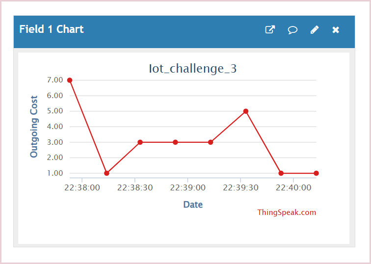
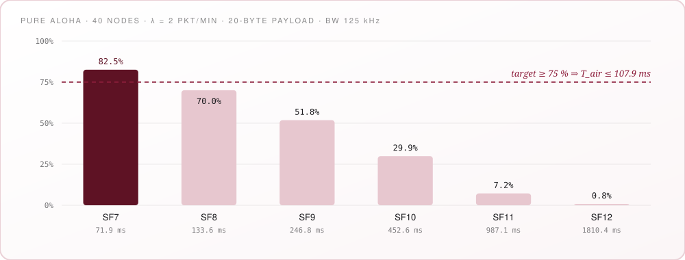

<p align="center">
  
</p>

<p align="center">
  
  
  
  
  
</p>

<p align="center"><i>
A ~5 200-row Wireshark capture of a ZigBee network goes in. A live dashboard, three CSV files and eight points<br>
on a public ThingSpeak channel come out. In between, a publisher and a subscriber exchange exactly 200 messages over a local MQTT broker.
</i></p>

---

## ✦ Contents

- [At a glance](#-at-a-glance)
- [How the flow is wired](#-how-the-flow-is-wired)
- [Four things that were harder than they looked](#-four-things-that-were-harder-than-they-looked)
- [Results](#-results)
- [Part 2: LoRaWAN spreading factors](#-part-2-lorawan-spreading-factors)
- [Run it yourself](#-run-it-yourself)
- [Repository layout](#-repository-layout)
- [Team & credits](#-team--credits)

---

## ✦ At a glance

| | |
|:--|:--|
| **Input** | `challenge3.csv`: 5 218 captured ZigBee packets (provided by the course) |
| **Transport** | MQTT on `localhost:1884`, topic `challenge3/id_generator`, QoS 0 |
| **Rate limits** | 1 ID/s in · 10 ZigBee msg/min out · 1 ThingSpeak point / 20 s |
| **Stops after** | exactly **200** messages, counted *before* filtering as the spec requires |
| **Outputs** | `id_log.csv` (200 rows) · `filtered_elems.csv` (24) · `outgoing_cost.csv` (70) · 2 live charts · 8 ThingSpeak points |

<p align="center">
  <br>
  <sub>The whole tab: initialization, publisher, subscriber and finalization branches.</sub>
</p>

---

## ✦ How the flow is wired

Four branches run in parallel on a single tab:



| Branch | What it does |
|:--|:--|
| **① Initialization** | Loads the capture once on deploy and indexes it **by Packet Number**, so each lookup is O(1) instead of a 5 218-row scan per message. It also rewrites the headers of the append-mode CSVs and resets every counter and flag, so each deploy starts clean. |
| **② Publisher** | Emits `{"id", "timestamp"}` every second and logs it. When the subscriber raises `flow.stop_generation`, it returns `null` and stops flooding the broker. |
| **③ Subscriber** | Counts first, then computes `N`, fetches the row and tags it `zbee_zcl` / `link_status` / `ignore`. ZCL packets are published again on `ZigBee/<source device>` (rate-limited) and mined for electrical attributes. Link Status packets update an ordered `(src, dst) → cost` map. |
| **④ Finalization** | Fires **once**, on the 200th message. It writes the cost map in arrival order, then separately picks the numerically smallest source, sorts its destinations and pushes the costs to ThingSpeak, one every 20 s (the free-tier limit). |

<details>
<summary><b>Branch close-ups</b> (from the report)</summary>
<br>
<p align="center">
  <br>
  <sub>Initialization: load and index the CSV on deploy, reset the output headers.</sub>
</p>
<p align="center">
  <br>
  <sub>Publisher: 1 Hz ID generator, MQTT out and CSV log.</sub>
</p>
</details>

A node-by-node walkthrough is in **[`Challenge.pdf`](Challenge.pdf)**. The JavaScript of all 15 function nodes is extracted into
**[`src/functions/`](src/functions)** for anyone who prefers reading code to clicking through the editor.

---

## ✦ Four things that were harder than they looked

<table>
<tr><td width="34"><b>1</b></td><td>

**The Command String column is Python, not JSON.** It uses single quotes and `True`/`False`/`None`. It has to be rewritten into real JSON
(double quotes, `true`/`false`/`null`) before anything can parse it.

</td></tr>
<tr><td><b>2</b></td><td>

**Not every ZBEE_ZCL packet carries data.** Only *Read Attributes Response* packets have Attribute, Status **and** Data Type
populated together. *Read Attributes*, *Report Attributes* and *Default Response* share the column layout but each is missing a
piece, so the filter rejects them at the gate rather than downstream.

</td></tr>
<tr><td><b>3</b></td><td>

**Int16 and Uint16 values arrive as two separate lists.** You cannot zip the attribute list against a single value list. You need
**one cursor per data type**, each advancing independently as you walk the attributes, so attribute, status, type and value stay aligned.

</td></tr>
<tr><td><b>4</b></td><td>

**The 200-message gate belongs *before* classification.** If it sits after, dropped packets stop counting and the flow overshoots.
The finalize trigger is also released **before** the JSON is parsed, so even a malformed 200th message cannot block finalization.

</td></tr>
</table>

---

## ✦ Results

**Live dashboard.** RMS voltage stays between **218 and 222 V**, consistent with European mains. RMS current is flat at **0 A**,
which suggests the metered device was in standby for the whole trace.

<p align="center">
  
</p>

**Link costs on ThingSpeak.** Nine ZigBee sources were observed. The smallest by hex value is the **Coordinator `0x0000`**. In this run it was only
the third source seen, so its links sit in rows 24–31 of `outgoing_cost.csv` and not at the top. This confirms the arrival-order CSV and the hex-sorted
ThingSpeak sequence are computed independently.

<table>
<tr>
<td width="48%" valign="top">

| # | Destination | Outgoing cost |
|:--:|:--:|:--:|
| 1 | `0x0112` | 7 |
| 2 | `0x1cd8` | 1 |
| 3 | `0x1e15` | 3 |
| 4 | `0x3d95` | 3 |
| 5 | `0x4e11` | 3 |
| 6 | `0xa706` | 5 |
| 7 | `0xe1a6` | 1 |
| 8 | `0xec7f` | 1 |

</td>
<td width="52%" align="center" valign="top">
  <br>
  <sub>Public channel <a href="https://thingspeak.com/channels/3340710">3340710</a>, one point every 20 s.</sub>
</td>
</tr>
</table>

Full outputs are in [`docs/data/`](docs/data): the 200 published IDs, the 24 filtered attribute rows (8 Read Attributes Response packets × 3 attributes)
and the 70-row link-cost map.

---

## ✦ Part 2: LoRaWAN spreading factors

A pen-and-paper exercise on an EU868 LoRaWAN network: **40 nodes**, Poisson traffic at **λ = 2 pkt/min**, 20-byte payload, BW 125 kHz,
all on the same SF. The full derivation is in **[`Exercise.pdf`](Exercise.pdf)**.

Under **pure ALOHA** the vulnerability window is 2·T<sub>air</sub>, so

$$
P_{\text{success}} = e^{-2G},\qquad G = N\,\lambda\,T_{\text{air}} = \tfrac{4}{3}\,T_{\text{air}}\ [\text{s}]
\quad\Longrightarrow\quad
P \ge 0.75 \iff T_{\text{air}} \le \frac{-\ln 0.75}{2\cdot 4/3} \approx 107.9\ \text{ms}
$$

<p align="center">
  
</p>

| | Question | Answer |
|:--|:--|:--|
| **EQ1** | Largest SF keeping success ≥ 75 % | **SF7** (≈ 82.5 %). SF8 (133.6 ms on air) already falls to ≈ 70 %. |
| **EQ2** | Success lower than expected and **uneven across nodes** | A **link-budget** problem, not a collision problem: **move the nodes closer to the gateway**. Collisions would hit all nodes alike. Removing nodes does not fix weak SNR, and raising the SF increases airtime and collisions for everyone. |

---

## ✦ Run it yourself

**You need:** Node-RED 4.x · Mosquitto listening on **`1884`** (not the default 1883) · `node-red-dashboard` · `challenge3.csv` in Node-RED's working directory.

```text
1.  Node-RED → menu → Import → paste flows.json
2.  mkdir challenge3_output          # in Node-RED's working dir, before the first deploy
3.  in "Split into individual ThingSpeak msg", replace
    YOUR_THINGSPEAK_WRITE_API_KEY with your own write key
4.  Deploy
```

The CSV loads itself, the headers are rewritten, and the publisher starts immediately and stops on its own after 200 IDs.

```bash
node tools/extract-functions.js           # re-export function-node code into src/functions/
node tools/extract-functions.js --check   # verify flows.json and src/functions/ have not drifted
```

> [!NOTE]
> - The ThingSpeak write key is redacted to `YOUR_THINGSPEAK_WRITE_API_KEY`. Use your own.
> - On the default port 1883 the MQTT nodes just sit disconnected. Mosquitto **must** listen on `1884`.
> - File-node paths are relative to where Node-RED was started, *not* to the location of `flows.json`.

---

## ✦ Repository layout

```text
.
├── flows.json                  # the flow: import this into Node-RED
├── flow.png                    # screenshot of the whole tab
├── src/functions/              # the 15 function nodes as readable .js
├── tools/extract-functions.js  # regenerates / checks src/functions/
├── docs/
│   ├── data/                   # id_log.csv · filtered_elems.csv · outgoing_cost.csv
│   ├── figures/                # figures from the report
│   └── assets/                 # banner + LoRa chart (SVG)
├── Challenge.pdf               # Part 1 report: the flow, node by node
└── Exercise.pdf                # Part 2 report: LoRaWAN exercise
```

`challenge3.csv` is the course's dataset and is not redistributed here.

---

## ✦ Team & credits

| | |
|:--|:--|
| **Golsa Shokri** | Part 1: Node-RED flow, MQTT routing, ZigBee packet parsing, CSV outputs, dashboard charts, ThingSpeak integration, Part 1 report |
| **Anasuya Satapathy** | Part 2: LoRaWAN spreading-factor analysis, EQ1 and EQ2 derivations, Part 2 report |

<p align="center"><sub>Politecnico di Milano · Internet of Things · IoT Challenge #3 · May 2026</sub></p>
